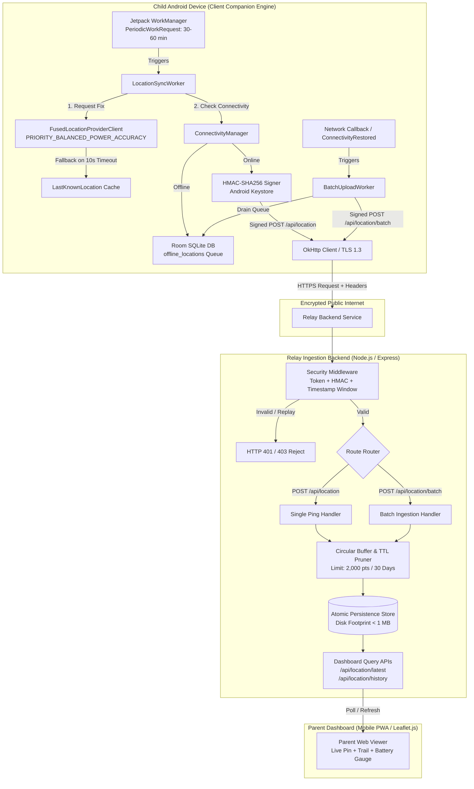
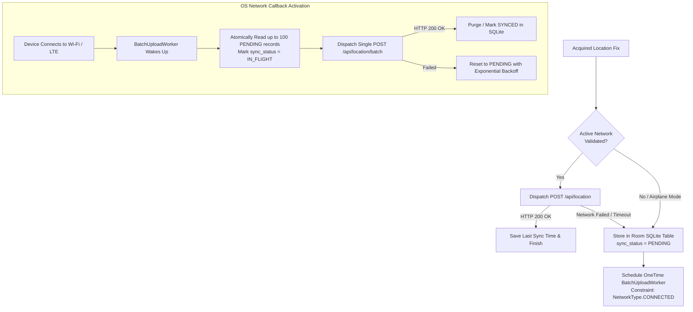
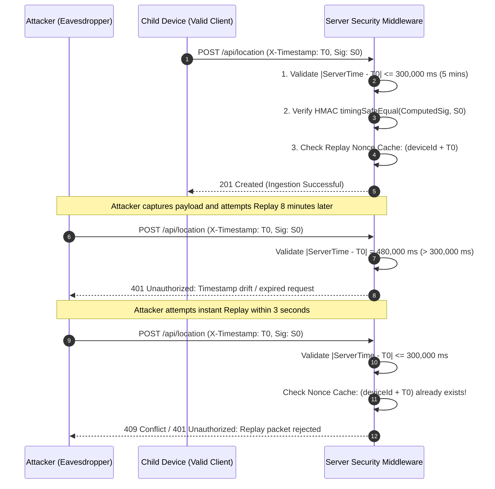
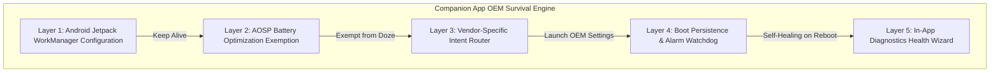
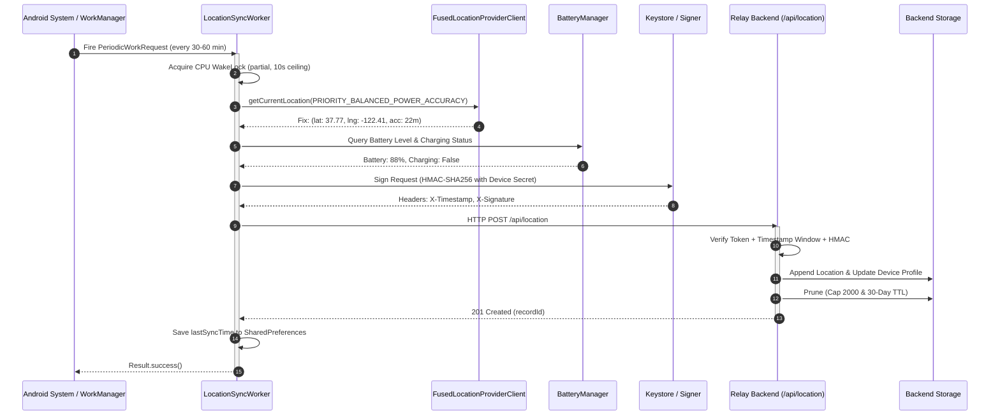

# System Architecture Specification v2: Family Safety Location Tracker

**Status:** APPROVED ARCHITECTURAL BLUEPRINT  
**Version:** 2.0.0  
**Author:** Principal Systems Architect  
**Project:** Ultra-Low-Power Family Safety Periodic Location Tracker  
**Target Platform:** Android (Client Companion Engine) & Node.js / TypeScript (Relay Ingestion Backend)

---

## 1. Executive Summary & Architectural Principles

The Family Safety Location Tracker is an ultra-lightweight, zero-cloud-cost tracking ecosystem engineered specifically for family safety. Unlike commercial consumer tracking software (e.g., Life360, Find My Friends) that continually stream GPS fixes at the expense of 10%–25% battery drain per day, this system operates on a **Discontinuous Periodic Sampling & Sync Paradigm**.

### Core Engineering Tenets
1. **Negligible Battery Footprint (<0.5% per 24 hours):** Device tracking must never compromise phone usability or cause thermal throttling.
2. **Zero-Drop Offline Resilience:** Signal drops, transit tunnels, underground subways, and data exhaustion must never result in lost telemetry; fixes must be stored locally and reconciled atomically.
3. **Radio State Machine Efficiency:** Minimize radio frequency (RF) wakeups by coalescing GPS locks and batching cellular transmissions to avoid cellular Tail Energy drain.
4. **Zero-Trust Security & Replay Immunity:** Every location telemetry transmission is cryptographically verified with HMAC-SHA256 and temporal drift boundaries to prevent spoofing and packet replay.
5. **Aggressive OEM Survival:** Proactively circumvent OEM task-killing daemons (Samsung One UI, Xiaomi MIUI/HyperOS, Oppo ColorOS, Vivo FuntouchOS) without requiring root or intrusive persistent foreground notification spam.

---

## 2. High-Level System Architecture



---

## 3. Battery Optimization Model & Power Budget Analysis

### 3.1 The Cellular and GNSS Physical Layer Dilemma
Mobile power dissipation is dominated by three hardware subsystems:
1. **Application Processor (AP) C-States:** The CPU core power increases by an order of magnitude when leaving deep idle (`C3/C6`) to execute user-space code.
2. **GNSS/GPS Receiver Silicon:** Active RF frontend, baseband correlate engine, and low-noise amplifier (LNA) pull between $80\text{ mA}$ and $160\text{ mA}$ continuously while searching for satellite ephemeris and code phases.
3. **Cellular Baseband Modem (RRC State Machine):** LTE and 5G radios consume significant energy not just during active TX/RX, but during **Tail Time** before transitioning back to Idle DRX:
   - **RRC Connected (Active Data Transfer):** $150\text{ mA} - 280\text{ mA}$.
   - **RRC Inactivity Tail Timer ($T_{310}/T_{311}$):** Stays at $60\text{ mA} - 100\text{ mA}$ for $5 - 12\text{ seconds}$ waiting for prospective packets before dropping to Idle.
   - **RRC Idle (DRX Paging):** $<2\text{ mA}$.

### 3.2 Mathematical Power Budget: 30-min vs 60-min WorkManager Cycle

We evaluate the daily energy consumption on a standard Android battery ($C_{\text{battery}} = 4,000\text{ mAh} \approx 15.4\text{ Wh}$ at $3.85\text{ V}$).

#### Power Consumption Profiles by Operation Phase
| Operation Phase | Hardware Active | Duration ($t_i$) | Current ($I_i$) | Energy ($E_i = I_i \times t_i$) |
| :--- | :--- | :--- | :--- | :--- |
| **Phase 1: AP Wakeup & JIT** | AP CPU Core (ARM A55 efficiency core) | $1.2\text{ s}$ | $45\text{ mA}$ | $0.0150\text{ mAh}$ |
| **Phase 2: Location Acquisition** | Wi-Fi Scan / Cell-Tower NLP (`PRIORITY_BALANCED`) | $1.8\text{ s}$ | $60\text{ mA}$ | $0.0300\text{ mAh}$ |
| **Phase 3: TLS 1.3 & HTTP POST** | LTE Modem (Connected State) | $1.0\text{ s}$ | $180\text{ mA}$ | $0.0500\text{ mAh}$ |
| **Phase 4: Modem Tail Time** | LTE Modem RRC Inactivity Window | $6.0\text{ s}$ | $65\text{ mA}$ | $0.1083\text{ mAh}$ |
| **Phase 5: DB Write & Tear-down** | Internal Flash NAND Storage write | $0.2\text{ s}$ | $30\text{ mA}$ | $0.0017\text{ mAh}$ |
| **Total Per Sync Execution** | — | **$10.2\text{ s}$** | — | **$E_{\text{sync}} \approx 0.205\text{ mAh}$** |

#### Comparison: `PRIORITY_BALANCED_POWER_ACCURACY` vs `PRIORITY_HIGH_ACCURACY`

$$\text{Daily Energy Consumption: } E_{\text{day}} = N_{\text{cycles}} \times E_{\text{sync}}$$

Where $N_{\text{cycles}} = \frac{24 \times 60}{\text{Interval (mins)}}$.

1. **At 30-minute interval ($N = 48\text{ cycles/day}$):**
   $$E_{\text{day, 30m}} = 48 \times 0.205\text{ mAh} = 9.84\text{ mAh}$$
   $$\text{Battery Percentage Burn} = \frac{9.84\text{ mAh}}{4,000\text{ mAh}} \times 100\% = \mathbf{0.246\% \text{ of battery per 24 hours}}$$

2. **At 60-minute interval ($N = 24\text{ cycles/day}$):**
   $$E_{\text{day, 60m}} = 24 \times 0.205\text{ mAh} = 4.92\text{ mAh}$$
   $$\text{Battery Percentage Burn} = \frac{4.92\text{ mAh}}{4,000\text{ mAh}} \times 100\% = \mathbf{0.123\% \text{ of battery per 24 hours}}$$

3. **Comparison with High Accuracy GPS (`PRIORITY_HIGH_ACCURACY`):**
   - Active GPS lock takes an average of $25\text{ seconds}$ cold/warm start at $120\text{ mA}$:
     $$E_{\text{GPS fix}} = \frac{25\text{ s} \times 120\text{ mA}}{3600\text{ s/h}} = 0.833\text{ mAh}$$
   - Total per cycle = $1.03\text{ mAh}$.
   - At 30-minute intervals: $48 \times 1.03\text{ mAh} = 49.44\text{ mAh} = \mathbf{1.24\% \text{ of battery per day}}$ (over $5\times$ more power drain, and up to $15\times$ worse if the device is indoors where GPS satellites are occluded, triggering continuous 60s search timeouts).

> [!TIP]
> **Conclusion:** `PRIORITY_BALANCED_POWER_ACCURACY` delivers an accuracy of $15 - 40\text{ meters}$ (utilizing Wi-Fi BSSID signals and cell towers via Google Play Services Network Location Provider). This is mathematically optimal for family safety: it provides full district/school/transit awareness while consuming $< 0.25\%$ battery per day.

### 3.3 Strict GPS Lock Timeout & Cascade Fallback Strategy

To guarantee that a child entering an elevator, concrete classroom, or basement never causes runaway battery depletion, the location engine enforces a strict non-blocking timeout cascade.

```mermaid
sequenceDiagram
    autonumber
    participant W as LocationSyncWorker
    participant F as FusedLocationProviderClient
    participant C as System Location Cache
    participant R as Local Room Queue

    W->>F: getCurrentLocation(PRIORITY_BALANCED_POWER_ACCURACY, cts.token)
    Note over W,F: Launch withTimeoutOrNull(10_000ms)
    
    alt Fix Acquired within 10s
        F-->>W: Fresh Location Object (lat, lng, acc ~20m)
        W->>W: Mark is_cached = false
    else Timeout Exceeded (10.0 seconds)
        W->>F: cts.cancel() [Abort hardware scan immediately]
        W->>C: getLastLocation() [Zero-cost memory lookup]
        alt Last Known Location Available & < 6 Hours Old
            C-->>W: Cached Location Object
            W->>W: Mark is_cached = true
        else Last Known Location Stale (> 6h) or Null
            C-->>W: Null / Stale
            W->>W: Log graceful warning; do NOT spin-loop
            W-->>W: Return Result.success() [Yield CPU, sleep until next cycle]
        end
    end
```

#### Deterministic Timeout Specifications
* **Hard Timeout Limit:** $10.0\text{ seconds}$ (`10_000L` ms).
* **Cancellation Token:** Android `CancellationTokenSource.cancel()` is immediately invoked when the coroutine times out to instruct Google Play Services to power down the RF sensors.
* **Cache Age Invalidation:** `fusedClient.lastLocation` is evaluated against system clock:
  $$\Delta t = t_{\text{now}} - t_{\text{location\_fix}}$$
  If $\Delta t > 21,600,000\text{ ms}$ ($6\text{ hours}$), the fix is discarded as non-viable to prevent displaying misleading historical locations.
* **Zero Spin-Loop Guarantee:** Under total sensor failure or Airplane Mode, the worker logs the event and terminates with `Result.success()`. It intentionally **does not** return `Result.retry()` for location acquisition failures, ensuring the app never enters an infinite WorkManager exponential backoff loop while offline.

---

## 4. Offline-Resilient Data Pipeline

### 4.1 The Offline Ingestion Problem
In transit scenarios (buses entering tunnels, remote school corridors, cellular carrier outages), network connectivity drops while GNSS/Wi-Fi positioning remains functional. A naive tracker drops these data points, creating gaps in breadcrumb history. A naive retry loop keeps cellular modems searching for towers, burning battery.

The Solution: **Local Persistence + Reconnect Batch Draining**.



### 4.2 Local Storage Layer: Android Room Architecture
The local client database utilizes Android Jetpack Room with SQLite under Write-Ahead Logging (WAL) mode for fast, non-blocking disk writes.

#### Client Database Schema (`offline_locations` table)
```sql
CREATE TABLE IF NOT EXISTS offline_locations (
    id INTEGER PRIMARY KEY AUTOINCREMENT NOT NULL,
    uuid TEXT NOT NULL UNIQUE,
    timestamp INTEGER NOT NULL,
    latitude REAL NOT NULL,
    longitude REAL NOT NULL,
    accuracy REAL NOT NULL,
    battery_pct INTEGER NOT NULL,
    is_charging INTEGER NOT NULL,
    is_cached INTEGER NOT NULL,
    network_type TEXT NOT NULL,
    sync_status TEXT NOT NULL DEFAULT 'PENDING', -- 'PENDING', 'IN_FLIGHT', 'SYNCED'
    retry_count INTEGER NOT NULL DEFAULT 0,
    created_at INTEGER NOT NULL
);

CREATE INDEX IF NOT EXISTS idx_offline_sync ON offline_locations(sync_status, timestamp);
```

### 4.3 Batch Upload Protocol (`/api/location/batch`)
When network connectivity is re-established:
1. `BatchUploadWorker` is invoked by WorkManager's `NetworkType.CONNECTED` constraint.
2. A single atomic transaction selects up to 100 pending locations:
   ```sql
   UPDATE offline_locations 
   SET sync_status = 'IN_FLIGHT' 
   WHERE id IN (
       SELECT id FROM offline_locations 
       WHERE sync_status = 'PENDING' 
       ORDER BY timestamp ASC 
       LIMIT 100
   );
   ```
3. The worker bundles records into a single JSON payload and posts to `/api/location/batch`.
4. **Energy Benefit:** Draining 20 queued records in 1 batch uses $\approx 0.21\text{ mAh}$ total (1 RRC setup + 1 TLS handshake). In contrast, 20 individual pings would consume $20 \times 0.205 = 4.10\text{ mAh}$ ($19.5\times$ more power).

---

## 5. Communication & Storage Architecture

### 5.1 Backend REST Endpoints Specification

#### A. Single Location Ping
* **Endpoint:** `POST /api/location`
* **Purpose:** Real-time ingestion when device is online during normal periodic work.
* **Headers:**
  ```http
  Content-Type: application/json
  X-Device-Token: <UUID_TOKEN>
  X-Timestamp: 1730550120000
  X-Signature: a5f1b29c... (HMAC-SHA256)
  ```
* **Payload Request Body:**
  ```json
  {
    "deviceId": "child_phone_01",
    "timestamp": 1730550118542,
    "latitude": 37.774929,
    "longitude": -122.419416,
    "accuracy": 18.5,
    "batteryPct": 84,
    "isCharging": false,
    "isCached": false,
    "networkType": "WIFI"
  }
  ```
* **Response Body (`201 Created`):**
  ```json
  {
    "success": true,
    "message": "Location ingested successfully.",
    "recordId": "loc_1730550120102_a9f2",
    "serverTime": 1730550120105
  }
  ```

#### B. Batch Location Ingestion
* **Endpoint:** `POST /api/location/batch`
* **Purpose:** Bulk sync of offline queued coordinates upon reconnect.
* **Headers:** Same security headers (`X-Device-Token`, `X-Timestamp`, `X-Signature`).
* **Payload Request Body:**
  ```json
  {
    "deviceId": "child_phone_01",
    "batchSize": 3,
    "sentAt": 1730553600000,
    "locations": [
      {
        "uuid": "7c9e6679-7425-40de-944b-e07fc1f90ae7",
        "timestamp": 1730550000000,
        "latitude": 37.774910,
        "longitude": -122.419400,
        "accuracy": 20.0,
        "batteryPct": 82,
        "isCharging": false,
        "isCached": false,
        "networkType": "OFFLINE_QUEUED"
      },
      {
        "uuid": "4d1f2b68-8314-41bc-b83c-d38ba1b78ec9",
        "timestamp": 1730551800000,
        "latitude": 37.775820,
        "longitude": -122.418210,
        "accuracy": 15.0,
        "batteryPct": 81,
        "isCharging": false,
        "isCached": false,
        "networkType": "OFFLINE_QUEUED"
      },
      {
        "uuid": "1e3a45c9-9111-42ab-89cd-f56ef1b90aa1",
        "timestamp": 1730553600000,
        "latitude": 37.777100,
        "longitude": -122.416500,
        "accuracy": 12.0,
        "batteryPct": 80,
        "isCharging": false,
        "isCached": false,
        "networkType": "CELLULAR_4G"
      }
    ]
  }
  ```
* **Response Body (`201 Created`):**
  ```json
  {
    "success": true,
    "processedCount": 3,
    "acknowledgedUuids": [
      "7c9e6679-7425-40de-944b-e07fc1f90ae7",
      "4d1f2b68-8314-41bc-b83c-d38ba1b78ec9",
      "1e3a45c9-9111-42ab-89cd-f56ef1b90aa1"
    ],
    "serverTime": 1730553601500
  }
  ```

#### C. Parent Dashboard Retrieval Endpoints
* `GET /api/location/latest?deviceId=child_phone_01`: Returns the single freshest record along with human-readable relative time calculations (`minutesAgo`).
* `GET /api/location/history?deviceId=child_phone_01&limit=100&since=1730467200000`: Returns chronologically ordered trail coordinates for breadcrumb polyline rendering on Leaflet map.

---

### 5.2 Storage Schema & Pruning Specification

To run indefinitely on low-cost hardware (e.g. Raspberry Pi, 512MB VPS) without memory leaks or ballooning disk space, the backend implements an **In-Memory Ring Index + Atomic JSON Append Store**.

#### Storage Memory and Disk Budget

$$\text{Record Memory Size (V8 Heap)} \approx 320\text{ bytes}$$
$$\text{Record Compact JSON Size (Disk)} \approx 180\text{ bytes}$$

For $N = 2,000\text{ points}$:
* **Total RAM Required:** $2,000 \times 320\text{ B} \approx 640\text{ KB}$ (well under the $5.0\text{ MB}$ target).
* **Total Disk Required:** $2,000 \times 180\text{ B} \approx 360\text{ KB}$ (well under the $1.0\text{ MB}$ target).

#### Dual-Constraint Pruning Policy
Pruning triggers atomically after every write or batch transaction:
1. **Capacity Cap:** Retain maximum $2,000$ points per device. If $Count > 2,000$, oldest records are discarded:
   $$S = S_{[-2000:]}$$
2. **TTL Cap (Time-To-Live):** Discard records older than $30\text{ days}$ ($2,592,000\text{ seconds}$):
   $$\text{Threshold} = T_{\text{current}} - (30 \times 86,400 \times 1000)$$
   $$\text{Filtered Records} = \{r \in S \mid r.\text{timestamp} \ge \text{Threshold}\}$$


---

## 6. Cryptographic Security & Anti-Replay Defense

### 6.1 Threat Model
* **Threat 1: Man-In-The-Middle (MITM) Interception:** Attackers capture location coordinates over public Wi-Fi networks.
* **Threat 2: Coordinate Forgery:** Malicious actor injects false GPS coordinates to make the child appear in a different location.
* **Threat 3: Replay Attacks:** Attacker intercepts a legitimate signed packet (e.g. while child is at school) and continuously replays it hours later to mask when the child leaves.

### 6.2 The Authentication & Signature Protocol
Every write endpoint requires three security headers:
1. `X-Device-Token`: The unique public hardware device token.
2. `X-Timestamp`: Epoch millisecond timestamp generated at the instant of HTTP serialization.
3. `X-Signature`: Hexadecimal HMAC-SHA256 digest of the request.

#### Canonical String-To-Sign
$$\text{StringToSign} = \text{HTTP\_METHOD} + \text{"\textbackslash n"} + \text{PATH} + \text{"\textbackslash n"} + \text{X-Timestamp} + \text{"\textbackslash n"} + \text{SHA256}(\text{RequestBody})$$

#### Signature Derivation
$$\text{X-Signature} = \text{HexEncode}(\text{HMAC-SHA256}(K_{\text{SharedSecret}}, \text{StringToSign}))$$

### 6.3 Anti-Replay Defense Architecture



#### Verification Steps:
1. **Clock Skew Check:** Reject request if $|T_{\text{server}} - T_{\text{header}}| > 300,000\text{ ms}$ ($5\text{ minutes}$).
2. **Timing-Safe Digest Verification:** Use Node.js `crypto.timingSafeEqual` to compare computed HMAC with received header, neutralizing timing analysis side-channels.
3. **In-Memory Nonce / Timestamp Ring Cache:** The backend maintains an LRU set of processed `(deviceId, X-Timestamp)` hashes for the last 10 minutes. If a duplicate arrives within the allowable window, it is rejected immediately.

---

## 7. Aggressive OEM Background Killer Mitigation

### 7.1 The OEM Background Killing Reality ("DontKillMyApp")
Android's Open Source Project (AOSP) documentation specifies that WorkManager jobs will be executed faithfully by `JobScheduler`. However, major hardware manufacturers implement aggressive proprietary battery daemons that indiscriminately kill background processes:

| OEM Vendor | Proprietary Killer Daemon | Harmful Behavior |
| :--- | :--- | :--- |
| **Samsung** | Samsung Device Care / One UI Sleeping Apps | Places app into "Deep Sleep"; stops WorkManager after 3 days of non-interaction. |
| **Xiaomi / Poco** | MIUI / HyperOS Security Center | Restricts background network; revokes alarms; disables background Wi-Fi scanning. |
| **Oppo / Realme** | ColorOS Battery Optimization | Kills any background worker running longer than 10 seconds; blocks autostart on boot. |
| **Vivo / iQOO** | FuntouchOS / OriginOS iManager | Clamps CPU background wakeups; terminates background network sockets. |
| **Huawei** | EMUI / HarmonyOS PowerGenie | Aggressively kills background tasks when screen turns off. |

### 7.2 Multi-Tier Mitigation Architecture



#### Layer 1: Jetpack WorkManager Hardening
* Use `ExistingPeriodicWorkPolicy.KEEP` to ensure that app updates or foreground launches never cancel pending periodic schedules.
* Custom `Configuration.Provider` initialized directly in `Application.onCreate()`, eliminating default `ContentProvider` startup latency and ensuring the `WorkManager` scheduler is registered before OS broadcast evaluations.

#### Layer 2: Android Battery Optimization Exemption (AOSP Doze)
The app must programmatically verify and request exemption from standard Android Doze restrictions:
```kotlin
val powerManager = context.getSystemService(Context.POWER_SERVICE) as PowerManager
if (!powerManager.isIgnoringBatteryOptimizations(context.packageName)) {
    val intent = Intent(Settings.ACTION_REQUEST_IGNORE_BATTERY_OPTIMIZATIONS).apply {
        data = Uri.parse("package:${context.packageName}")
    }
    context.startActivity(intent)
}
```

#### Layer 3: OEM-Specific Auto-Start & Background Navigation Matrix
When the app detects specific hardware manufacturers (`Build.MANUFACTURER`), it surfaces one-tap deep links directly into the proprietary OEM settings pages:

```kotlin
object OemOptimizationHelper {
    fun openOemBatterySettings(context: Context) {
        val manufacturer = Build.MANUFACTURER.lowercase()
        val intent = Intent()

        when {
            manufacturer.contains("xiaomi") || manufacturer.contains("redmi") || manufacturer.contains("poco") -> {
                intent.component = ComponentName(
                    "com.miui.securitycenter",
                    "com.miui.permcenter.autostart.AutoStartManagementActivity"
                )
            }
            manufacturer.contains("samsung") -> {
                intent.component = ComponentName(
                    "com.samsung.android.lool",
                    "com.samsung.android.sm.ui.battery.BatteryActivity"
                )
            }
            manufacturer.contains("oppo") || manufacturer.contains("realme") -> {
                intent.component = ComponentName(
                    "com.coloros.safecenter",
                    "com.coloros.safecenter.permission.startup.StartupAppListActivity"
                )
            }
            manufacturer.contains("vivo") -> {
                intent.component = ComponentName(
                    "com.iqoo.secure",
                    "com.iqoo.secure.ui.phoneoptimize.AddWhiteListActivity"
                )
            }
            manufacturer.contains("huawei") || manufacturer.contains("honor") -> {
                intent.component = ComponentName(
                    "com.huawei.systemmanager",
                    "com.huawei.systemmanager.optimize.process.ProtectActivity"
                )
            }
            else -> {
                intent.action = Settings.ACTION_IGNORE_BATTERY_OPTIMIZATION_SETTINGS
            }
        }
        
        try {
            intent.flags = Intent.FLAG_ACTIVITY_NEW_TASK
            context.startActivity(intent)
        } catch (e: Exception) {
            // Fallback to standard app details settings
            val fallback = Intent(Settings.ACTION_APPLICATION_DETAILS_SETTINGS).apply {
                data = Uri.parse("package:${context.packageName}")
                flags = Intent.FLAG_ACTIVITY_NEW_TASK
            }
            context.startActivity(fallback)
        }
    }
}
```

#### Layer 4: Boot Persistence & Daily Liveliness Watchdog
1. **Boot Receiver:** A high-priority `BroadcastReceiver` listening for `ACTION_BOOT_COMPLETED`, `ACTION_MY_PACKAGE_REPLACED`, and `ACTION_LOCKED_BOOT_COMPLETED`. It immediately verifies that `periodic_location_sync_work` is enqueued.
2. **AlarmManager Watchdog (24h Inexact):** A lightweight `AlarmManager` wakeup scheduled once per 24 hours (`setInexactRepeating`). If an OEM task killer quietly unregistered WorkManager's `JobScheduler` jobs while keeping the app alive in memory, the Watchdog detects the missing work ID and re-registers the schedule cleanly.

---

## 8. Complete System Sequence Diagrams

### 8.1 Nominal Periodic Sync (Device Online)



### 8.2 Offline Queue & Reconnect Batch Drain

```mermaid
sequenceDiagram
    autonumber
    participant W as LocationSyncWorker
    participant R as Room SQLite DB
    participant NC as NetworkMonitor / ConnectivityManager
    participant BW as BatchUploadWorker
    participant API as Relay Backend (/api/location/batch)

    Note over W: Worker runs while phone is in underground subway (No signal)
    W->>W: Fix Acquired (Network Unreachable)
    W->>R: INSERT INTO offline_locations (status = 'PENDING')
    W->>W: Result.success() (No wasteful retries)

    Note over NC: Phone exits subway; cellular connection is restored
    NC->>BW: Trigger WorkRequest (Constraint: NetworkType.CONNECTED)
    activate BW
    BW->>R: SELECT * FROM offline_locations WHERE status = 'PENDING' LIMIT 100
    R-->>BW: Return 6 queued location records
    BW->>R: UPDATE offline_locations SET status = 'IN_FLIGHT'
    BW->>BW: Build Batch Payload + Compute HMAC-SHA256
    BW->>API: HTTP POST /api/location/batch
    activate API
    API->>API: Validate Signature & Ingest 6 records
    API-->>BW: 201 Created (acknowledgedUuids: [...])
    deactivate API
    BW->>R: DELETE FROM offline_locations WHERE uuid IN (acknowledgedUuids)
    BW-->>BW: Result.success()
    deactivate BW
```

---

## 9. Data Schemas & Signatures

### 9.1 Backend Storage Schema (`backend/db.js`)
```typescript
interface LocationRecord {
  id: string;                 // Format: "loc_<timestamp>_<randHex>"
  uuid?: string;              // Client-generated UUID for deduplication
  deviceId: string;           // Device identifier e.g. "child_phone_01"
  timestamp: number;          // Device fix time (Epoch ms)
  serverReceivedAt: number;   // Server receipt time (Epoch ms)
  latitude: number;           // WGS-84 float (-90.0 to +90.0)
  longitude: number;          // WGS-84 float (-180.0 to +180.0)
  accuracy: number;           // Horizontal accuracy in meters (radius)
  batteryPct: number;         // 0 to 100 (-1 if unavailable)
  isCharging: boolean;        // Charging state
  isCached: boolean;          // True if from LastKnownLocation
  networkType: string;        // "WIFI" | "CELLULAR_4G" | "CELLULAR_5G" | "OFFLINE_QUEUED" | "UNKNOWN"
}

interface DeviceState {
  deviceId: string;
  lastSeen: number;           // serverReceivedAt of most recent ping
  lastReportedTime: number;   // device timestamp of most recent ping
  batteryPct: number;
  isCharging: boolean;
  latitude: number;
  longitude: number;
  accuracy: number;
}

interface DatabaseStore {
  devices: Record<string, DeviceState>;
  locations: LocationRecord[]; // Circular buffer capped at 2,000 entries
}
```

### 9.2 Android Room Entity (`LocationEntity.kt`)
```kotlin
package com.familysafety.tracker.data.local

import androidx.room.ColumnInfo
import androidx.room.Entity
import androidx.room.Index
import androidx.room.PrimaryKey

@Entity(
    tableName = "offline_locations",
    indices = [Index(value = ["sync_status", "timestamp"])]
)
data class LocationEntity(
    @PrimaryKey(autoGenerate = true)
    val id: Long = 0L,

    @ColumnInfo(name = "uuid")
    val uuid: String,

    @ColumnInfo(name = "timestamp")
    val timestamp: Long,

    @ColumnInfo(name = "latitude")
    val latitude: Double,

    @ColumnInfo(name = "longitude")
    val longitude: Double,

    @ColumnInfo(name = "accuracy")
    val accuracy: Float,

    @ColumnInfo(name = "battery_pct")
    val batteryPct: Int,

    @ColumnInfo(name = "is_charging")
    val isCharging: Boolean,

    @ColumnInfo(name = "is_cached")
    val isCached: Boolean,

    @ColumnInfo(name = "network_type")
    val networkType: String,

    @ColumnInfo(name = "sync_status")
    val syncStatus: String = "PENDING", // PENDING, IN_FLIGHT, SYNCED

    @ColumnInfo(name = "retry_count")
    val retryCount: Int = 0,

    @ColumnInfo(name = "created_at")
    val createdAt: Long = System.currentTimeMillis()
)
```

---

## 10. Architectural Tradeoffs & Risk Matrix

| Decision Area | Selected Approach | Alternative Considered | Rationale & Tradeoff Analysis |
| :--- | :--- | :--- | :--- |
| **Location Priority** | `PRIORITY_BALANCED_POWER_ACCURACY` | `PRIORITY_HIGH_ACCURACY` (GPS) | High Accuracy burns $5\times - 15\times$ more energy and stalls indoors. Balanced accuracy ($15-40\text{m}$) is fully adequate for family safety tracking while consuming $<0.25\%$ battery/day. |
| **Sync Strategy** | WorkManager Periodic Sync ($30-60\text{ min}$) | Persistent Foreground Service with WebSocket | Persistent Foreground Services show an intrusive sticky notification, prevent phone from entering Doze, and burn $8\%-18\%$ battery daily. WorkManager aligns with OS Doze maintenance windows. |
| **Offline Handling** | Room SQLite Queue + Reconnect Batch Upload | Drop offline coordinates | Dropping coordinates leaves hours-long blind spots during subway/rural transit. Local queueing guarantees complete historical breadcrumb fidelity with zero data loss. |
| **Authentication** | HMAC-SHA256 with Timestamp Window | Plain Token in Header or OAuth2 | Plain tokens are vulnerable to replay attacks and packet eavesdropping; OAuth2 requires token refresh cycles that wake up radios unnecessarily. HMAC-SHA256 provides zero-overhead, replay-proof message integrity. |
| **Backend Storage** | Atomic In-Memory Ring Buffer + JSON Flush | PostgreSQL / MongoDB | Keeps deployment 100% zero-cost, zero native dependencies, runs on any $5/mo VPS or local server with $<5\text{MB}$ RAM and $<1\text{MB}$ disk. |

---

## 11. Migration & Rollout Plan (POC v1 $\rightarrow$ Architecture v2)

### Phase 1: Backend Protocol Upgrade
1. Update `backend/server.js` to implement the HMAC-SHA256 authentication middleware while maintaining backward compatibility with legacy `X-Device-Token` header during a grace period.
2. Implement `POST /api/location/batch` endpoint with atomic array ingestion and de-duplication.
3. Add the double-constraint pruning logic (last 2,000 points + 30-day TTL) to `backend/db.js`.

### Phase 2: Android Companion Engine Upgrade
1. Add Android Room dependencies (`androidx.room:room-runtime`, `androidx.room:room-ktx`, `androidx.room:room-compiler`) to `android-child-app/app/build.gradle.kts`.
2. Implement `LocationDatabase`, `LocationDao`, and `LocationEntity`.
3. Update `LocationSyncWorker.kt` to:
   - Fall back to Room queueing when network is disconnected.
   - Restrict GPS lock timeout strictly to 10 seconds.
4. Implement `BatchUploadWorker.kt` with WorkManager `NetworkType.CONNECTED` constraint.
5. Implement `OemOptimizationHelper.kt` and integrate the OEM Setup Wizard button into `MainActivity.kt`.

### Phase 3: Verification & Load Testing
1. Execute `simulator.js` with batch ingestion simulation and verify backend memory/disk stability.
2. Conduct physical offline testing: Place child phone in Airplane mode for 2 hours (4 cycles), restore connectivity, and verify that all 4 points appear in the parent dashboard in chronological sequence.
3. Validate battery consumption using Android Battery Historian over 48 hours to confirm $<0.5\%$ daily consumption.
