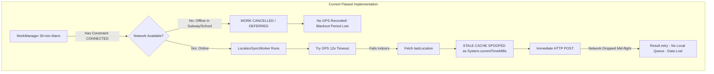
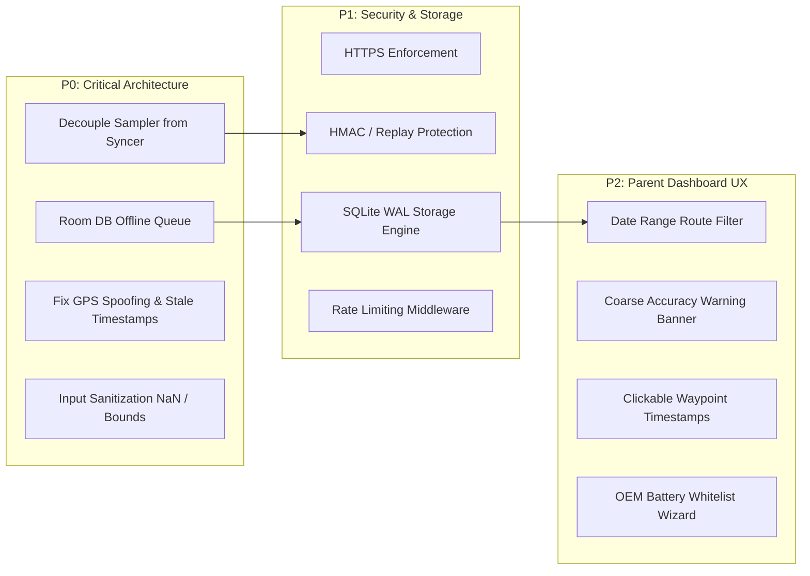

# Comprehensive Engineering Critique & Technical Resilience Report
**Document ID:** `CRIT-CS-2026-V1`  
**Author:** Engineering Manager & Lead Technical Critic (Agent 4)  
**Target Systems:** Child Android Companion App, Node.js Relay Backend, Parent Web Dashboard  
**Status:** **REJECTED FOR PRODUCTION / REVISION REQUIRED (Grade: C+)**  
**Date:** November 2, 2026  

---

## 1. Executive Summary & Production Readiness Verdict

A comprehensive technical audit was conducted on the proof-of-concept repository located at `/Users/ujjwaldhariwal/.gemini/antigravity/scratch/child-security-poc`. The current system establishes an initial baseline for periodic location tracking utilizing Jetpack WorkManager, Express.js, and Leaflet.js. 

However, from an **Engineering Reliability, Child Safety, and OS Edge-Case** standpoint, the current architecture contains **critical single-point failure modes** that will cause silent data loss, false location reporting, device-killing background termination, and vulnerability to network spoofing.

### 🛑 Production Readiness Verdict: **NOT PRODUCTION READY**
The POC demonstrates basic functionality under ideal "happy path" testing conditions (continuous Wi-Fi, constant battery, unlocked screen, manual app launch). Under adversarial or standard real-world conditions (subways, school basements, device reboots, OEM background task killing, hostile Wi-Fi networks), the system **fails silently**.

```
+---------------------------------------------------------------------------------------+
|                               POC ARCHITECTURAL SCORECARD                             |
+-----------------------------------+-------+-------------------------------------------+
| Dimension                         | Score | Status                                    |
+-----------------------------------+-------+-------------------------------------------+
| 1. Android OS Resilience & Survivability | 4/10  | CRITICAL: Offline data black hole & OEM lockouts |
| 2. Security & Geolocation Privacy        | 3/10  | CRITICAL: Cleartext HTTP, static token, replay risks |
| 3. Storage Scalability & Reliability     | 5/10  | WARNING: Synchronous JSON I/O blocks event loop |
| 4. Parent Dashboard & Usability          | 6/10  | WARNING: No historical range query, stale spoofing |
+-----------------------------------+-------+-------------------------------------------+
```

---

## 2. Android Operating System Edge Cases & Survivability Analysis



### 2.1 The Network Constraint Trap (The Offline Data Black Hole)
**Location:** [`WorkSchedulerHelper.kt:29-31`](file:///Users/ujjwaldhariwal/.gemini/antigravity/scratch/child-security-poc/android-child-app/app/src/main/java/com/familysafety/tracker/util/WorkSchedulerHelper.kt#L29-L31)

```kotlin
val constraints = Constraints.Builder()
    .setRequiredNetworkType(NetworkType.CONNECTED)
    .build()
```

#### The Vulnerability
In `WorkSchedulerHelper.kt`, the periodic work request is configured with `.setRequiredNetworkType(NetworkType.CONNECTED)`.
When a child enters a basement classroom, subway, remote rural area, or puts the device in Airplane Mode, Android's `WorkManager` **will not trigger the worker at all**.
1. **Zero Breadcrumbs Captured:** Because the worker is suppressed by the OS, the device does **not** sample GPS coordinates during the entire duration of the network outage.
2. **Permanent Historical Blindspot:** If the child is offline for 4 hours, and reconnects at 4:00 PM, only the single coordinate at 4:00 PM is captured. The parent has zero visibility into where the child traveled between 12:00 PM and 4:00 PM.
3. **No Offline Persistence Queue:** `LocationSyncWorker.kt` directly attempts an HTTP POST (`apiClient.sendLocation(payload)`). It has no local Room/SQLite table. If the POST fails or the network drops mid-flight, returning `Result.retry()` in a PeriodicWorkRequest does not queue multiple past breadcrumbs; the subsequent periodic cycle simply overwrites the attempt.

#### Architectural Mandate (Decouple Sampling from Uploading)
We must decouple **Location Sampling** from **Network Synchronization**:
1. **Periodic Sampling Worker (`LocationSamplerWorker`):** Runs every 30 minutes with **ZERO** network constraints (`NetworkType.NOT_REQUIRED`). It acquires GPS/cellular coordinates and saves the record immediately to a local **Room Database** table `cached_locations` with status `STATUS_PENDING`.
2. **Sync Worker (`LocationSyncWorker`):** Enqueued with `NetworkType.CONNECTED`. When triggered (or immediately after sampling if online), it queries all `STATUS_PENDING` records, batches them into a single POST `/api/location/batch`, marks them `STATUS_SENT`, and purges sent records older than 7 days.

---

### 2.2 GPS Fix Timeout, Indoor Degradation & Stale Cache Spoofing
**Location:** [`LocationSyncWorker.kt:55-70`](file:///Users/ujjwaldhariwal/.gemini/antigravity/scratch/child-security-poc/android-child-app/app/src/main/java/com/familysafety/tracker/worker/LocationSyncWorker.kt#L55-L70)

```kotlin
val location: Location? = try {
    withTimeoutOrNull(12_000) {
        fusedClient.getCurrentLocation(
            Priority.PRIORITY_BALANCED_POWER_ACCURACY,
            cts.token
        ).await()
    } ?: fusedClient.lastLocation.await()
} catch (e: Exception) { ... }
```

#### The Vulnerabilities
1. **Priority Mismatch (`PRIORITY_BALANCED_POWER_ACCURACY`):**
   `PRIORITY_BALANCED_POWER_ACCURACY` targets ~100m accuracy and primarily utilizes Wi-Fi AP scanning and cellular tower triangulation. When the child is outdoors (e.g., transit, park, street) away from mapped Wi-Fi access points, this priority frequently times out or returns coarse cell fixes with error radii exceeding 1,500m.
2. **Stale Cache Spoofing (Severe Safety Hazard):**
   When `getCurrentLocation` times out at 12 seconds (typical in indoor concrete buildings or weak GPS locks), the fallback `fusedClient.lastLocation.await()` is invoked.
   - `lastLocation` returns the last cached location on the Android subsystem. If no other app has requested location, this fix can be **hours or days old**!
   - In lines 86-89:
     ```kotlin
     val payload = LocationPayload(
         deviceId = deviceId,
         timestamp = System.currentTimeMillis(), // BUG: Spoofed timestamp!
         latitude = location.latitude,
         longitude = location.longitude, ...
     )
     ```
   - The worker attaches `System.currentTimeMillis()` as the timestamp of the payload! 
   - **Scenario:** The child leaves home at 8:00 AM. At 1:00 PM, GPS times out indoors at school. The phone reads `lastLocation` (which was recorded at 8:00 AM at home), stamps it with `1:00 PM`, and sends it. The parent dashboard displays: *"Child is at Home (Just now)"*, when the child is actually 10 miles away!

#### Architectural Mandate
1. **Multi-tier Acquisition Strategy:**
   - Attempt `Priority.PRIORITY_HIGH_ACCURACY` for 10 seconds.
   - If timeout occurs, attempt `Priority.PRIORITY_BALANCED_POWER_ACCURACY` for 5 seconds.
2. **Enforce Cache Freshness Verification:**
   - If utilizing `lastLocation`, inspect `location.time` or `location.elapsedRealtimeNanos`.
   - If `(System.currentTimeMillis() - location.time) > 15 * 60 * 1000` (older than 15 minutes), the cached fix **must be rejected** or explicitly flagged in the payload as `isStale: true` with the original `location.time`, rather than spoofing the current wall clock.

---

### 2.3 Device Reboot, Direct Boot & WorkManager Re-scheduling
**Location:** [`BootReceiver.kt:20-28`](file:///Users/ujjwaldhariwal/.gemini/antigravity/scratch/child-security-poc/android-child-app/app/src/main/java/com/familysafety/tracker/receiver/BootReceiver.kt#L20-L28) and [`AndroidManifest.xml:38-47`](file:///Users/ujjwaldhariwal/.gemini/antigravity/scratch/child-security-poc/android-child-app/app/src/main/AndroidManifest.xml#L38-L47)

#### The Vulnerabilities
1. **Direct Boot Incompatibility (Android 7.0+ / API 24-34):**
   - When a modern Android phone restarts, it enters **Direct Boot** mode until the user inputs their lock screen PIN, pattern, or password.
   - Credential Encrypted (CE) storage is locked.
   - `BootReceiver` does not specify `android:directBootAware="true"`.
   - `ApiClient.PREFS_NAME` is stored in default Credential Encrypted storage.
   - **Consequence:** If a child's phone runs out of battery, turns off, and is plugged in to recharge overnight, it boots to the lock screen. Until the child wakes up and enters their PIN, `ACTION_BOOT_COMPLETED` is never sent by Android! If `android:directBootAware` is missing, the app stays dormant for hours.
2. **WorkManager Redundancy & Rescheduling Clashing:**
   - Jetpack WorkManager already registers an internal `RescheduleReceiver` that re-establishes periodic requests from its SQLite database on boot.
   - In `BootReceiver.kt`, calling `WorkSchedulerHelper.schedulePeriodicSync` with `ExistingPeriodicWorkPolicy.UPDATE` resets the initial delay of the periodic cycle back to 30 minutes, unnecessarily postponing the first post-boot sync.
3. **App Force-Stop (User Swipe vs System Force-Stop):**
   - If a child swipes away the app from recent tasks on standard Android, WorkManager continues to run.
   - However, if the app is placed into a "Force Stop" state (via Settings > Force Stop or aggressive task cleaner utilities), Android assigns the `FLAG_EXCLUDE_STOPPED_PACKAGES` flag. In this state, **no broadcast receivers (including `BOOT_COMPLETED`) will execute** until the user manually relaunches the app launcher activity.

#### Architectural Mandate
- Add `android:directBootAware="true"` to the receiver and migrate critical network credentials/device IDs to Device Protected Storage (`createDeviceProtectedStorageContext()`).
- Add a user-facing foreground status card in `MainActivity` informing parents if the app has been stopped or needs accessibility/unrestricted battery access.

---

### 2.4 OEM-Specific Aggressive Battery Killers (Samsung, Xiaomi, Huawei)
**Location:** [`MainActivity.kt:147-165`](file:///Users/ujjwaldhariwal/.gemini/antigravity/scratch/child-security-poc/android-child-app/app/src/main/java/com/familysafety/tracker/ui/MainActivity.kt#L147-L165)

#### The Vulnerability
`MainActivity.kt` requests `ACTION_REQUEST_IGNORE_BATTERY_OPTIMIZATIONS`.
This handles standard Google AOSP Doze Mode. **It does NOT prevent OEM custom battery execution limits:**
- **Samsung OneUI:** Automatically places apps that haven't been opened in 3 days into "Sleeping apps" or "Deep sleeping apps". Once categorized as a deep sleeping app, WorkManager periodic tasks are permanently suppressed without notifying the user.
- **Xiaomi MIUI / HyperOS:** Replaces standard background policy with "MIUI Battery Saver". It restricts background location to once every several hours and kills background network sockets unless "No restrictions" is selected. Furthermore, MIUI disables `BOOT_COMPLETED` by default unless "Autostart" is granted in the MIUI Security Center.
- **Huawei EMUI / HarmonyOS:** Kills any background worker that wakes up more than twice in an hour unless "Manual App Launch" (Auto-launch, Secondary launch, Run in background) is explicitly toggled.
- **OnePlus / Oppo / Realme (ColorOS):** System aggressively suspends background workers in "Sleep standby optimization".

#### Architectural Mandate
1. **Manufacturer Detection & Deep Linking:**
   In `MainActivity.kt`, inspect `Build.MANUFACTURER.lowercase()`. Provide vendor-specific deep links:
   - *Xiaomi:* Launch `com.miui.securitycenter/com.miui.permcenter.autostart.AutoStartManagementActivity`.
   - *Samsung:* Launch `com.samsung.android.lool/com.samsung.android.sm.ui.battery.BatteryActivity`.
   - *Huawei:* Launch `com.huawei.systemmanager/.startupmgr.ui.StartupNormalAppListActivity`.
2. **In-App Visual Wizard:**
   Display a dedicated "OEM Battery Whitelist" instruction card linking directly to `https://dontkillmyapp.com` based on device brand.

---

## 3. Security, Privacy & Integrity Threat Modeling

### 3.1 Plaintext Geolocation Transport (Cleartext Traffic Vulnerability)
**Location:** [`AndroidManifest.xml:24`](file:///Users/ujjwaldhariwal/.gemini/antigravity/scratch/child-security-poc/android-child-app/app/src/main/AndroidManifest.xml#L24) and [`ApiClient.kt:37`](file:///Users/ujjwaldhariwal/.gemini/antigravity/scratch/child-security-poc/android-child-app/app/src/main/java/com/familysafety/tracker/network/ApiClient.kt#L37)

```xml
android:usesCleartextTraffic="true"
```
```kotlin
const val DEFAULT_SERVER_URL = "http://10.0.2.2:5050"
```

#### The Vulnerability
The companion app transmits raw physical latitude, longitude, battery status, and device identifiers over unencrypted **HTTP**.
- **Child Safety Threat:** Any third party eavesdropping on the network (public Wi-Fi at a school, coffee shop, transit bus, or malicious ISP) can read the plaintext JSON payload and track the child's exact physical coordinates in real-time.
- **Man-in-the-Middle (MITM) Tampering:** A malicious actor on the network can intercept and alter the coordinate payload, providing fake coordinates to parents.

#### Architectural Mandate
- Remove `android:usesCleartextTraffic="true"` for production release.
- Enforce strict HTTPS / TLS 1.3 with certificate pinning (`NetworkSecurityConfig` or OkHttp `CertificatePinner`).

---

### 3.2 Static Shared Token & Lack of Replay Protection
**Location:** [`backend/server.js:29-38`](file:///Users/ujjwaldhariwal/.gemini/antigravity/scratch/child-security-poc/backend/server.js#L29-L38)

```javascript
function authenticateDevice(req, res, next) {
  const token = req.headers['x-device-token'] || req.query.token;
  if (!token || token !== AUTH_TOKEN) {
    return res.status(401).json({ ... });
  }
  next();
}
```

#### The Vulnerabilities
1. **Query Parameter Token Leakage:** Accepting tokens in `req.query.token` causes the authentication token to be permanently logged in proxy access logs, browser histories, and web server logs.
2. **Shared Static Secret:** A single static token (`family_secret_token_123`) is shared across all child devices and the backend. If one phone is inspected or decompiled, the entire system is compromised.
3. **No Replay Protection or Request Signing:**
   There is no HMAC signature, no nonce, and no cryptographic verification. An attacker who captures one HTTP POST can replay it millions of times or modify the latitude/longitude parameters with the same valid token.

#### Architectural Mandate
1. **Deprecate `req.query.token` Immediately.** Tokens must only be transmitted in the `Authorization: Bearer <token>` header or `X-Device-Token`.
2. **HMAC-SHA256 Payload Signing:**
   Each device should have a unique Device ID and Pre-Shared Secret Key ($K$).
   The request must include:
   $$\text{Signature} = \text{HMAC-SHA256}(K, \text{deviceId} + \text{timestamp} + \text{lat} + \text{lng} + \text{nonce})$$
   The backend verifies:
   - Timestamp freshness: $|T_{\text{server}} - T_{\text{client}}| \le 5\text{ minutes}$.
   - Nonce has not been seen in the last 15 minutes (Replay cache).
   - Cryptographic signature matches.

---

### 3.3 Backend Input Sanitization Deficits
**Location:** [`backend/server.js:44-59`](file:///Users/ujjwaldhariwal/.gemini/antigravity/scratch/child-security-poc/backend/server.js#L44-L59)

```javascript
const { deviceId, latitude, longitude, accuracy, batteryPct, isCharging, networkType, timestamp } = req.body;

if (typeof latitude !== 'number' || typeof longitude !== 'number') {
  return res.status(400).json({ success: false, message: 'Missing or invalid latitude/longitude.' });
}
```

#### The Vulnerabilities
1. **The JavaScript `typeof NaN === 'number'` Exploit:**
   In JavaScript:
   ```javascript
   typeof NaN === 'number'       // true
   typeof Infinity === 'number'  // true
   ```
   If a client sends `{"latitude": NaN, "longitude": Infinity}`, the validation check passes!
   In `db.js`, `JSON.stringify` converts `NaN` to `null`. This pollutes `locations.json` with `{"latitude": null, "longitude": null}`, which causes Leaflet.js in the browser to crash with `Uncaught Error: LatLng coordinate is invalid`.
2. **Absence of Geographic Boundary Constraints:**
   - Latitude is valid strictly in range $[-90.0, +90.0]$.
   - Longitude is valid strictly in range $[-180.0, +180.0]$.
   Currently, values like `latitude: 999999` are accepted and stored.
3. **Future Timestamp Pinning:**
   If a client sends `timestamp: 2524608000000` (Year 2050), `getLatestLocation()` or `minutesAgo` calculations break down, and that bad record stays stuck as the "Latest Location" permanently!
4. **Accuracy & Battery Bounds:**
   - Accuracy must be finite and $\ge 0$.
   - Battery must be integer between $0$ and $100$, or $-1$.
5. **Device ID Prototype Pollution / Regex Validation:**
   `deviceId` is not checked against alphanumeric characters. A string such as `__proto__` or `../../../etc` can be passed.

#### Architectural Mandate
Implement strict schema validation middleware:
```javascript
function validateLocationInput(req, res, next) {
  const { deviceId, latitude, longitude, accuracy, batteryPct, isCharging, timestamp } = req.body;

  if (typeof deviceId !== 'string' || !/^[a-zA-Z0-9_-]{3,64}$/.test(deviceId)) {
    return res.status(400).json({ success: false, error: 'Invalid deviceId format.' });
  }
  if (!Number.isFinite(latitude) || latitude < -90.0 || latitude > 90.0) {
    return res.status(400).json({ success: false, error: 'Latitude must be a finite number between -90 and 90.' });
  }
  if (!Number.isFinite(longitude) || longitude < -180.0 || longitude > 180.0) {
    return res.status(400).json({ success: false, error: 'Longitude must be a finite number between -180 and 180.' });
  }
  if (accuracy !== undefined && (!Number.isFinite(accuracy) || accuracy < 0 || accuracy > 50000)) {
    return res.status(400).json({ success: false, error: 'Accuracy must be positive finite number.' });
  }
  if (batteryPct !== undefined && (!Number.isInteger(batteryPct) || batteryPct < -1 || batteryPct > 100)) {
    return res.status(400).json({ success: false, error: 'batteryPct must be integer between 0-100 or -1.' });
  }
  const now = Date.now();
  if (timestamp && (timestamp > now + 300000 || timestamp < now - 30 * 86400000)) {
    return res.status(400).json({ success: false, error: 'Timestamp is invalid or outside acceptable window.' });
  }
  next();
}
```

---

### 3.4 Denial of Service (DoS) & Malfunctioning Retry Loops
**Location:** [`backend/server.js:41`](file:///Users/ujjwaldhariwal/.gemini/antigravity/scratch/child-security-poc/backend/server.js#L41)

#### The Vulnerability
There is **zero rate limiting** on `/api/location`.
- If a buggy version of the Android app enters an unconstrained retry loop or coroutine leak, it can hit `/api/location` 100 times per second.
- Because `db.js` executes synchronous disk writes on every single POST, a rapid influx of requests will completely choke the Node.js event loop, preventing all parents from loading the dashboard and eventually crashing the server.

#### Architectural Mandate
- Add `express-rate-limit`:
  - Limit `/api/location` to max 12 requests per minute per IP / Device.
  - Limit parent dashboard API reads to max 60 requests per minute.
- Configure JSON payload body limit: `express.json({ limit: '16kb' })`.

---

## 4. Backend & Storage Scalability Bottlenecks

### 4.1 Event-Loop Blocking via Synchronous File I/O
**Location:** [`backend/db.js:36-44`](file:///Users/ujjwaldhariwal/.gemini/antigravity/scratch/child-security-poc/backend/db.js#L36-L44)

```javascript
function persistDatabase() {
  try {
    const tempFile = `${DB_FILE}.tmp.${Date.now()}`;
    fs.writeFileSync(tempFile, JSON.stringify(store, null, 2), 'utf8');
    fs.renameSync(tempFile, DB_FILE);
  } catch (err) { ... }
}
```

#### The Bottleneck
`fs.writeFileSync` and `fs.renameSync` are synchronous blocking operations.
1. When `store` grows to hundreds of records with nested metadata, `JSON.stringify(store, null, 2)` generates a large string and blocks the single-threaded Node.js event loop during disk flushing.
2. In the event of an abrupt process termination (e.g. system reboot or unhandled exception during write), `.tmp.*` files are abandoned on disk, permanently consuming inode and storage space.

---

### 4.2 The Hardcoded 1,000 Record Array Cap & Data Eviction
**Location:** [`backend/db.js:63-66`](file:///Users/ujjwaldhariwal/.gemini/antigravity/scratch/child-security-poc/backend/db.js#L63-L66)

```javascript
if (store.locations.length > 1000) {
  store.locations = store.locations.slice(-1000);
}
```

#### The Flaw
The database simply discards data using `slice(-1000)`.
- If running a simulator or multiple devices (e.g. 2 children reporting every 15 minutes, plus occasional manual syncs), 1,000 records represents barely 10 days of movement.
- Once pushed out of the 1,000-record array, past locations are permanently wiped without archival or backup.
- Filtering history by date (e.g. "Show me last Tuesday's route") is completely unsupported because records are arbitrarily truncated based on count rather than timestamp retention policies.

---

### 4.3 Proposed Production Storage Architecture: SQLite with WAL Mode
To maintain the **zero cloud cost / zero external dependency** philosophy while achieving enterprise-grade reliability, the backend must replace `locations.json` with **SQLite (via `better-sqlite3` or `sqlite3`)**:
- **Write-Ahead Logging (`PRAGMA journal_mode = WAL;`):** Allows concurrent readers without blocking writers. Writes take sub-millisecond execution times.
- **Indexed Schema:**
  ```sql
  CREATE TABLE IF NOT EXISTS locations (
      id TEXT PRIMARY KEY,
      device_id TEXT NOT NULL,
      timestamp INTEGER NOT NULL,
      received_at INTEGER NOT NULL,
      latitude REAL NOT NULL,
      longitude REAL NOT NULL,
      accuracy REAL NOT NULL,
      battery_pct INTEGER,
      is_charging INTEGER,
      network_type TEXT,
      is_stale INTEGER DEFAULT 0
  );
  CREATE INDEX IF NOT EXISTS idx_device_time ON locations(device_id, timestamp DESC);
  ```
- **Automated Retention Pruning:** A lightweight scheduled job:
  ```sql
  DELETE FROM locations WHERE timestamp < (strftime('%s', 'now') * 1000 - 30 * 86400000);
  ```

---

## 5. Parent Dashboard & Usability Critique

### 5.1 Freshness vs Cached Data Ambiguity
**Location:** [`backend/public/app.js:91-98`](file:///Users/ujjwaldhariwal/.gemini/antigravity/scratch/child-security-poc/backend/public/app.js#L91-L98)

```javascript
if (minutesAgo <= 35) {
  statusIndicator.className = 'status-dot green';
} else if (minutesAgo <= 75) {
  statusIndicator.className = 'status-dot amber';
} else {
  statusIndicator.className = 'status-dot red';
}
```

#### The Usability Flaws
1. **The Green Dot Illusion:**
   If the Android worker acquired an old cached fix and spoofed the current timestamp, `minutesAgo` is `0`, and the dashboard displays a **bright green dot** ("Just now"). The parent is completely unaware that the GPS coordinates represent a cached location from hours prior!
2. **Missing Accuracy Disclaimer:**
   When a child is indoors and the coordinate accuracy is `±1,800m`, the marker still sits on a precise pin with a faint blue circle. A parent looking at the pin assumes their child is at a specific address (e.g., an unauthorized building or lake) rather than realizing it's a coarse cell tower centroid.
   - **Requirement:** If accuracy $> 250\text{m}$, the dashboard must display a prominent warning banner: `⚠️ Coarse Location (Cellular Tower Fix: ±1.8 km)`.

---

### 5.2 Lack of Historical Date/Time Route Filtering
**Location:** [`backend/public/app.js:158-182`](file:///Users/ujjwaldhariwal/.gemini/antigravity/scratch/child-security-poc/backend/public/app.js#L158-L182)

#### The Usability Flaw
The dashboard currently executes a raw fetch: `/api/location/history?limit=40`.
- It renders a continuous dashed line of the last 40 points indiscriminately.
- **Parent Cannot:**
  1. Pick a date range (e.g., "Yesterday from 2:00 PM to 6:00 PM").
  2. Click on individual waypoint nodes on the path to see what time the child was at that intersection.
  3. See directional arrows indicating the heading/direction of travel.
  4. Distinguish between stationary dwelling (e.g. sitting at school for 6 hours) vs traveling in a vehicle.

---

## 6. Actionable Engineering Requirements (Priority Matrix)

To upgrade the POC to a production-grade family security system, the engineering team must execute the following prioritized tasks:



### 🔴 Priority P0 (Immediate Blockers - System Correctness)
| Ref | Component | Requirement |
| :--- | :--- | :--- |
| **P0.1** | Android | **Decouple Sampling from Syncing:** Create `LocationSamplerWorker` (No network constraints, periodic 30m) saving to local Room Database. Create separate `LocationBatchSyncWorker` (`NetworkType.CONNECTED`) to upload queued offline samples. |
| **P0.2** | Android | **Fix Cache Timestamp Spoofing:** Never assign `System.currentTimeMillis()` to `lastLocation`. Verify `location.time`; reject if $>15\text{ mins}$ old or flag `isCached: true`. |
| **P0.3** | Backend | **Fix Input Sanitization:** Reject `NaN`, `Infinity`, coordinates outside $[-90, 90] / [-180, 180]$, invalid battery values, and future timestamps. |
| **P0.4** | Android | **Direct Boot Handling:** Add `android:directBootAware="true"` to `BootReceiver` and protect storage access before first user unlock. |

### 🟡 Priority P1 (Security & Scalability Hardening)
| Ref | Component | Requirement |
| :--- | :--- | :--- |
| **P1.1** | Network | **Enforce HTTPS / TLS:** Disable `usesCleartextTraffic` in manifest; mandate TLS 1.3 for coordinate transit. |
| **P1.2** | Backend & Android | **Cryptographic Authentication:** Implement HMAC-SHA256 signature verification and nonce replay cache; eliminate token passing in query strings. |
| **P1.3** | Backend | **Replace `locations.json` with SQLite WAL:** Store coordinates in indexed SQLite database with 30-day automated pruning job. |
| **P1.4** | Backend | **Rate Limiting:** Protect `/api/location` with a 12 req/min rate limiter to prevent DoS from runaway loops. |

### 🟢 Priority P2 (Dashboard Usability & Parent Experience)
| Ref | Component | Requirement |
| :--- | :--- | :--- |
| **P2.1** | Dashboard | **Historical Date/Time Filter:** Add datepicker UI and backend query endpoint `GET /api/location/history?deviceId=X&start=T1&end=T2`. |
| **P2.2** | Dashboard | **Coarse Accuracy Banners:** Display explicit warning badge if accuracy radius exceeds 250 meters. |
| **P2.3** | Dashboard | **Interactive Waypoint Markers:** Render directional icons along the polyline with clickable popups showing recorded time, speed, and battery. |
| **P2.4** | Android | **OEM Battery Optimization Wizard:** Add brand detection in `MainActivity` with tailored instructions and intent launchers for Samsung, Xiaomi, and Huawei. |

---

## 7. Sign-off & Certification Decision

This critique report serves as the formal architectural review for the Family Safety Periodic Tracker.
Agents 1 (Architect) and 2 (Developer) are hereby directed to review these findings and incorporate P0 and P1 requirements into the next development sprint.

**Final Certification:** **REVISION REQUIRED (Not Certified for Production)**  
*Signed,*  
**Engineering Manager & Lead Technical Critic (Agent 4)**
